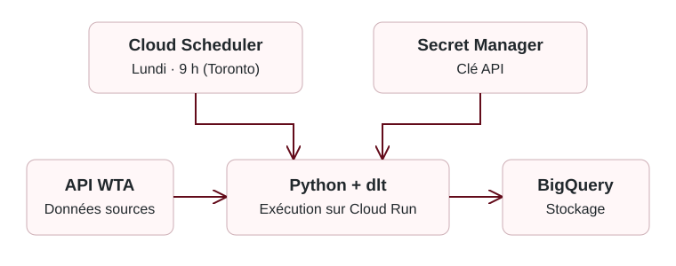
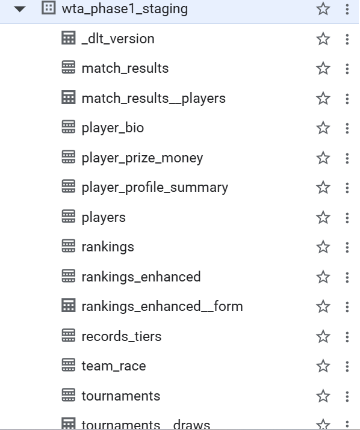

IFT 3150 · Automne 2026 <strong>Player data</strong>

# Le projet

**Nassim Barhoumi** · Superviseur : Louis-Edouard Lafontant (DIRO, Université de Montréal)

!!! success "Au 19 octobre 2026"
    **Pipeline WTA complété et déployé : environ 400 000 lignes chargées.**
    Il reste à ajouter **Cloud Monitoring** et à **vérifier le dataset**.

## Problématique

Tennis Canada a besoin de données centralisées et à jour pour suivre les athlètes et analyser leurs performances. Le projet automatise leur récupération et leur chargement dans BigQuery, déjà utilisé par l'organisation.

La **WTA est traitée en premier** : son historique est accessible, contrairement à celui de l'ITF au moment du choix.

## Solution réalisée : pipeline WTA

- **Données :** joueuses, classements, tournois, résultats et statistiques.
- **Traitement :** Python et dlt structurent les données et les chargent dans BigQuery.
- **Mise à jour :** chaque lundi à 9 h (Toronto), avec Cloud Run et Cloud Scheduler.
- **Volume :** environ 400 000 lignes dans le dataset, pas 400 000 matchs distincts.

### Le staging dans BigQuery

Le **staging** est une zone intermédiaire : dlt y charge le lot récupéré avant de le fusionner dans les tables finales avec `merge`, selon les identifiants configurés.

**Données WTA → staging → tables finales BigQuery**

**Pourquoi ce choix ?** L'API peut renvoyer des données déjà chargées, parfois corrigées. Un simple ajout (`append`) pourrait créer des doublons ; remplacer toute la table (`replace`) avec seulement la saison actuelle ferait perdre l'historique. Le mode `merge` de dlt utilise le staging pour préparer le lot avant de l'intégrer aux tables finales selon les clés configurées.

Une solution sans staging serait possible, mais demanderait une autre stratégie de chargement ou davantage de logique à développer. Ici, le choix est de réutiliser le mécanisme fourni par dlt.

Cette étape prépare les mises à jour ; elle ne remplace pas la vérification de la qualité du dataset.

Voir les tables de staging

Structure des tables intermédiaires, sans affichage des données.

## Collaboration

- **Nassim :** développement du pipeline.
- **Direction de Tennis Canada :** supervision et priorités.
- **Scientifique des données en chef (INS Québec) :** analyses pour la haute performance.
- **Entraîneurs :** futurs utilisateurs des rapports.

Les besoins concernent le développement des athlètes, la haute performance et les tournois.

## Prochaines étapes

**D'ici le 30 octobre :** ajouter Cloud Monitoring pour les alertes d'échec et vérifier la qualité et la couverture du dataset.

La suite prévoit l'ITF, puis l'ATP selon les accès disponibles. Voir le [suivi et l'échéancier](suivi.md).

*Les données sous licence et les clés d'accès restent privées.*
