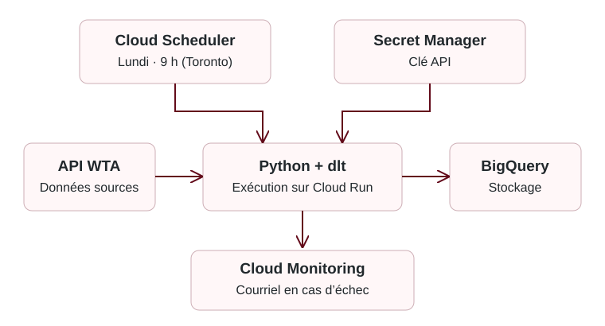
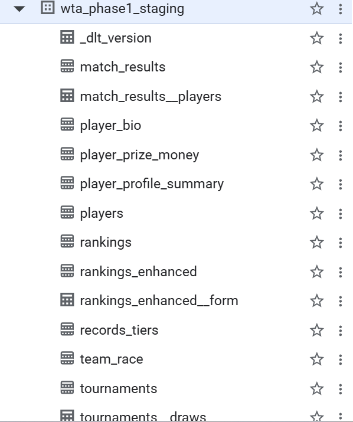

IFT 3150 · Automne 2026 <strong>Player data</strong>

# Le projet

**Nassim Barhoumi** · Superviseur : Louis-Edouard Lafontant (DIRO, Université de Montréal)

!!! success "Mise à jour du 18 novembre 2026"
    **Pipeline WTA déployé, alertes en place et premières vérifications réalisées.**
    Après correction de la pagination, la table `match_results` contient **environ 2,6 millions de lignes**.

## Problématique

Tennis Canada a besoin de données centralisées et à jour pour suivre les athlètes et analyser leurs performances. Le projet automatise leur récupération et leur chargement dans BigQuery, déjà utilisé par l'organisation.

La **WTA est traitée en premier** : son historique est accessible, contrairement à celui de l'ITF au moment du choix.

## Solution réalisée : pipeline WTA

- **Données :** joueuses, classements, tournois et résultats.
- **Traitement :** Python et dlt structurent les données et les chargent dans BigQuery.
- **Mise à jour :** chaque lundi à 9 h (Toronto), avec Cloud Run et Cloud Scheduler.
- **Surveillance :** Cloud Monitoring envoie un courriel en cas d’échec.
- **Relances :** deux exécutions successives ont conservé les volumes, sans doublon sur les clés naturelles dans le test réalisé.

### Le staging dans BigQuery

Le **staging** est une zone intermédiaire : dlt y charge le lot récupéré avant de le fusionner dans les tables finales avec `merge`, selon les identifiants configurés.

**Données WTA → staging → tables finales BigQuery**

Le mode `merge` permet d’intégrer les ajouts et corrections selon les clés configurées. Il évite de simplement ajouter les mêmes lignes à chaque relance ou de remplacer tout l’historique par le lot courant.

Voir les tables de staging

## Résultats des vérifications

Un bug de pagination tronquait l’historique sans faire échouer le job. Après correction et rechargement, `match_results` est passée d’environ **488 000 à 2,6 millions de lignes**. Les vérifications indiquent que les données disponibles dans l’API pour **2000–2025** ont été chargées.

La majorité des résultats concerne des **tournois ITF féminins**. Il faut filtrer pour une analyse WTA seule et éviter le double comptage avec une autre source ITF. Les résultats avant 2000 sont peu fournis et l’endpoint de statistiques de saison ne renvoie aucune donnée lors des vérifications.

## Collaboration

- **Nassim :** développement du pipeline.
- **Direction de Tennis Canada :** supervision et priorités.
- **Scientifique des données en chef (INS Québec) :** analyses pour la haute performance.
- **Entraîneurs :** futurs utilisateurs des rapports.

Les besoins concernent le développement des athlètes, la haute performance et les tournois.

## Prochaines étapes

Traiter les anomalies restantes et préciser les filtres et limites des analyses. Une correspondance entre identifiants ITF et WTA est en place, ainsi que les descriptions des tables et colonnes.

L’extraction ITF a commencé. Le travail sur l’ATP dépend de l’accès aux données. Voir le [suivi et l'échéancier](suivi.md).

**Présentation finale :** du 11 au 17 décembre 2026, en présentiel, pendant 25 minutes incluant les questions. Créneau à confirmer avec le superviseur.

*Les données sous licence et les clés d'accès restent privées.*
